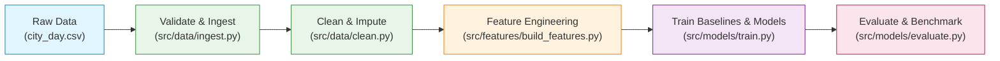

# AI-Based Air Quality Awareness Assistant (MLOps Milestone 1)

[](https://www.python.org/downloads/)
[](https://dvc.org/)
[](https://mlflow.org/)
[](https://github.com/psf/black)
[](https://github.com/astral-sh/ruff)

## 1. Project Overview & Problem Statement

Urban air pollution is a critical environmental and public health crisis across Indian metropolitan centers. This project builds a reliable, reproducible MLOps system that forecasts air quality 24 hours in advance and translates numeric predictions into actionable, human-centered health advisories.

### Linked ML Tasks
- **Task A (Regression):** Predict numeric next-day Air Quality Index (`AQI`, 0–500+) based on historical pollutant readings.
- **Task B (Classification):** Categorize next-day air quality into one of the 6 official Indian CPCB tiers (`Good`, `Satisfactory`, `Moderate`, `Poor`, `Very Poor`, `Severe`).

---

## 2. Milestone 1 Scope & Architecture

Milestone 1 implements the complete foundational MLOps data and modeling workflow:
1. **Dataset Acquisition & Governance:** CPCB India daily air quality (2015–2020), data card, faculty approval.
2. **Data Exploration (EDA):** Seasonality, missingness, spatial patterns, COVID-19 anomaly analysis.
3. **Reproducible Pipeline (DVC):** Fully tracked DAG (`dvc.yaml`) from ingestion to evaluation.
4. **Leakage-Free Feature Engineering:** Lags, rolling statistics, calendar encodings, chronological splits.
5. **Baselines & ML Modeling:** Naive persistence baselines vs. Ridge, Random Forest, XGBoost, LightGBM.
6. **Experiment Tracking (MLflow):** Parameter logging, metrics, artifacts, runs comparison.
7. **Comprehensive Evaluation:** Error breakdowns by city, season, and AQI severity; Bengaluru spotlight.



---

## 3. Repository Structure

```
aqi-awareness-assistant/
├── .dvc/                      # DVC configuration
├── .github/                   # GitHub Actions (CI workflows)
├── data/
│   ├── raw/                   # Raw immutable datasets (DVC-tracked)
│   ├── interim/               # Cleaned datasets (DVC output)
│   └── processed/             # Feature matrices (train/val/test)
├── docs/
│   ├── dataset_approval.md    # Faculty approval request & sign-off
│   ├── data_card.md           # Formal dataset documentation
│   └── decisions.md           # Architecture Decision Records (ADRs)
├── models/                    # Serialized models and scalers (DVC-tracked)
├── notebooks/
│   └── 01_eda.ipynb           # Exploratory Data Analysis
├── reports/
│   ├── figures/               # High-res diagnostic & evaluation figures
│   ├── metrics/               # Evaluation metrics JSONs
│   └── milestone1_report.md   # Milestone 1 technical report
├── src/
│   ├── config.py              # Configuration manager (reads params.yaml)
│   ├── data/
│   │   ├── ingest.py          # Data ingestion pipeline
│   │   ├── clean.py           # Cleaning, imputation, outlier handling
│   │   └── validate.py        # Schema and range validation
│   ├── features/
│   │   ├── aqi_utils.py       # CPCB thresholds & health advice logic
│   │   └── build_features.py  # Temporal feature generator & scaler
│   ├── models/
│   │   ├── baselines.py       # Naive and statistical baselines
│   │   ├── train.py           # Training pipeline with MLflow logging
│   │   └── evaluate.py        # Test set evaluation & diagnostic plots
│   └── utils/
│       └── logging_utils.py   # Centralized logging setup
├── tests/
│   ├── test_aqi_utils.py      # Unit tests for AQI bucket conversions
│   ├── test_features.py       # Feature alignment tests
│   └── test_no_leakage.py     # Temporal leakage assertions
├── .dvcignore
├── .gitignore
├── .pre-commit-config.yaml
├── dvc.yaml                   # DVC pipeline stages
├── params.yaml                # Master project configuration
├── pyproject.toml             # Ruff, Black, and Pytest configuration
├── requirements.txt           # Pinned dependencies
└── README.md
```

---

## 4. Quick Start & Setup

### 4.1 Prerequisites
- Python 3.10+
- Git 2.30+

### 4.2 Installation
```bash
# Clone the repository
git clone <repository-url>
cd aqi-awareness-assistant

# Create and activate virtual environment
python -m venv .venv

# Windows:
.venv\Scripts\activate
# Linux/macOS:
source .venv/bin/activate

# Install pinned dependencies
pip install -r requirements.txt

# Install pre-commit hooks
pre-commit install
```

### 4.3 Reproducing the Pipeline with DVC
```bash
# Pull data from remote (if configured)
dvc pull

# Reproduce the full pipeline end-to-end
dvc repro

# View pipeline execution DAG
dvc dag
```

### 4.4 Running Tests
```bash
pytest -v
```

### 4.5 Inspecting Experiments with MLflow
```bash
mlflow ui --backend-store-uri sqlite:///mlflow.db --port 5000
```
Open [http://localhost:5000](http://localhost:5000) in your browser.

---

## 5. Branching & Contribution Strategy

- **`main`**: Production-ready, always runnable branch. Protected against direct pushes.
- **`feature/<name>`**: Feature branches corresponding to development phases (e.g., `feature/data-validation`, `feature/dvc-setup`, `feature/baselines`).
- **Commits**: Conventional Commits convention (`feat:`, `fix:`, `docs:`, `chore:`, `test:`, `refactor:`).
- **Code Review**: Peer-reviewed PRs between Student A and Student B.

---

## 6. Team & Academic Credits

- **Course:** AI252TA: Machine Learning Operations
- **Student Team:**
  - Student A: [Name / USN / GitHub]
  - Student B: [Name / USN / GitHub]
- **Faculty Mentor:** [Faculty Name]

---

## 7. License

This project is licensed under the MIT License - see the LICENSE file for details.
